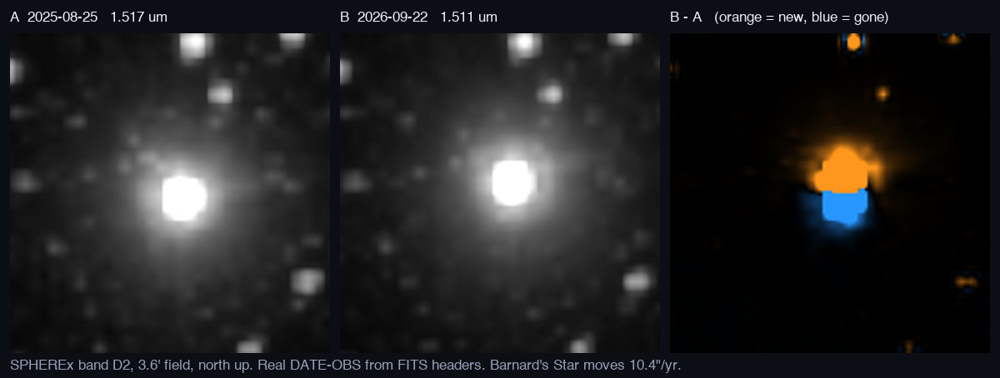

# Blink X

**Watch the sky change in NASA's SPHEREx images.**
A public web tool for the NASA Space Apps Challenge 2026 — *Planet X and SPHEREx* — by team **KhoFra**.

Type a star or galaxy name (or RA/Dec), and Blink X finds every SPHEREx exposure of that spot,
lines them up, and lets you **blink** between dates, put them **side by side**, **subtract** one
from the other, or play them as a **time-lapse**. Things that moved — asteroids, comets, nearby
stars — pop out. It is the 1930 blink comparator that found Pluto, pointed at a 2025–26 all-sky
infrared survey, in a browser, on a phone.

- **Live demo:** <https://khozhijon.github.io/blinkx/> (the saved examples open instantly; live search
  of the whole archive runs on a small free server that needs about a minute to wake up)
- **Data:** real SPHEREx Level-2 spectral images from NASA/IPAC IRSA. Every date shown is the
  `DATE-OBS` keyword of the FITS file it came from. Nothing is simulated.



## What it does

| | |
|---|---|
| Search | Object name (CDS Sesame: SIMBAD → NED → VizieR) or coordinates in degrees / sexagesimal. Nearby stars are shifted from their year-2000 catalogue position to where they are now, using their catalogued proper motion. |
| Epochs | All Level-2 spectral images covering the position (IRSA SIA2, collections `spherex_dr1`, `spherex_qr3` and the two `_deep` ones), grouped into visits. SPHEREx returns to most of the sky about every six months. |
| Cutouts | 3′, 6′, 12′ or 24′ fields, resampled onto one north-up grid so every date lines up pixel for pixel. |
| Compare | Blink (A ↔ B), side by side with a linked cursor, difference (B − A: orange = new, blue = gone), time-lapse with a slider. |
| Colour band | Any of SPHEREx's six detector bands (0.75–5.0 µm). The exact wavelength of each exposure *at your position* is shown, because SPHEREx's filters vary across the detector. |
| Display | Brightness, black level, three colour maps, optional brightness matching between dates, smooth or raw pixels. |
| Examples | Preset targets saved as static files, so the demo still works if the archive is slow or down. |
| Extras | Labels for known asteroids and comets in the field at that moment (IMCCE SkyBoT); mark suspected movers and copy their coordinates; every view has a shareable link. |

## The saved examples

| Example | What you see | SPHEREx data |
|---|---|---|
| Interstellar comet 3I/ATLAS | A comet from another star crosses a 12′ field in 3 h 20 min | 12 exposures, 14 Dec 2025, band 2 |
| Asteroid Vesta on the move | The brightest asteroid moves 6′ in ten hours | 11 exposures, 16–17 Jul 2026, band 2 |
| Spot the asteroid | (16) Psyche looks like a star until you blink | 8 exposures, 9 Sep 2025, band 3 |
| Barnard's Star | The fastest star in the sky shifts 11″ in 13 months | 20 exposures, Aug 2025 – Sep 2026, band 2 |
| A comet's hidden gas | 3I/ATLAS swells into a cloud at 4.26 µm, where CO₂ glows | 12 exposures, 14 Dec 2025, band 5 |

The moving objects were found by `scripts/find_movers.py`: it takes an ephemeris from JPL Horizons,
asks IRSA which exposures cover the object's position at that time, and confirms on the real
image that there is a source on the predicted spot and nothing there in the other frames
(`scripts/mover_candidates.json`). Not every search succeeds: comet C/2025 R2 (SWAN), for example,
had no SPHEREx exposure in its 21–26 October 2025 window.

## Run it locally (one command)

```bash
./run.sh
```

Then open <http://localhost:8000>. The script uses [`uv`](https://docs.astral.sh/uv/) if you have
it (recommended: it picks Python 3.12 for you), otherwise it makes a `.venv` with `python3 -m venv`
(Python 3.11–3.13).

Tests (offline, a second or so):

```bash
pip install -r requirements-dev.txt && python -m pytest -q
```

Rebuild the saved examples from the live archive:

```bash
python scripts/build_examples.py
```

## How it works

```
browser (plain HTML/JS, canvas)
   │  /api/resolve   name → RA/Dec                      CDS Sesame
   │  /api/search    which exposures cover this spot    IRSA SIA2
   │  /api/frames    date + wavelength of each one      FITS headers  ┐ HTTP range requests on the
   │  /api/frame     one aligned cutout, as numbers     pixel rows    ┘ NASA copy on AWS (S3)
   │  /api/known-objects  catalogued asteroids/comets   IMCCE SkyBoT
   ▼
FastAPI backend (backend/) with an on-disk cache
```

A SPHEREx Level-2 image is a 62 MB multi-extension FITS file. Blink X never downloads a whole
one. For each exposure it reads:

1. the first ~40 kB: the header with `DATE-OBS`, the WCS (TAN + SIP distortion) and the keys of the
   spectral WCS;
2. only the detector rows that the cutout touches (a few hundred kB) from the `IMAGE` extension;
3. the same rows of the `FLAGS` extension, which is Rice-compressed one row per tile, so single rows
   can be decompressed on their own;
4. once per detector, the tiny `WCS-WAVE` lookup table at the end of the file, to get the wavelength
   at the target pixel.

The files are fetched from the public `nasa-irsa-spherex` bucket that IRSA lists in the SIA
`cloud_access` column, with IRSA's on-premises URL as fallback. Reading this way takes about half
a second per exposure and puts no cutout load on IRSA.

Each cutout is then resampled (bilinear) onto a north-up tangent-plane grid centred on the target.
Pixels the SPHEREx pipeline flagged as unusable (cosmic-ray hits, dead/hot pixels, missing data) are
filled from their good neighbours; the UI can show exactly which ones. The sky level (median) and
noise (MAD) are measured per frame, and the pixels travel to the browser as numbers rather than
pictures, so stretching, blinking and subtracting happen instantly on the device.

Checks made against the archive (see `spike/`): the wavelength lookup, observation date and pixel
values agree exactly with a cutout made by IRSA's own cutout service for the same file, and the
FLAGS decoder matches it bit for bit.

### Honest limits

- Every SPHEREx exposure sees one narrow infrared colour that changes across the detector, so two
  dates are never taken at exactly the same wavelength. Blink X picks the closest pair by default and
  can match star brightness between frames, but a star can still differ for that reason alone.
- SPHEREx pixels are 6.15″. Motions smaller than a few arcseconds between dates are not visible.
- Known-object positions are geocentric; SPHEREx is in low Earth orbit, a difference well under a
  pixel for main-belt asteroids.
- Names of asteroids and comets cannot be typed into the search box: they have no fixed position.
  Use the examples, or a position and date range you already know.
- Live search depends on IRSA's query service to say which exposures cover a position. When it is
  slow or down, Blink X retries, reuses an earlier answer if it has one (and says so), and keeps a
  small saved index for well-known targets in `seed/`. The saved examples need no archive at all.
- In SPHEREx's two deep fields (near the ecliptic poles) a spot has tens of thousands of exposures;
  Blink X shows an even sample in time.
- "Mark a mover" keeps marks on your own device; there is no shared list yet.

## Deploy

One free service runs everything (API + page): see `render.yaml`.

1. Push this repository to GitHub.
2. On <https://render.com>: **New → Blueprint**, choose the repository, **Apply**.
3. Open the `https://<name>.onrender.com` address Render shows.

Free Render services sleep after 15 minutes without visitors and take about a minute to wake.
To give visitors an instant first page, also publish `frontend/` as a static site (GitHub Pages,
Netlify or Vercel) and set the backend address in `frontend/config.js`; the saved examples then load
with no backend at all, and live search wakes up in the background.

## Repository layout

```
backend/     FastAPI app: spherex.py (archive access + image maths), resolver.py, skybot.py, cache.py, main.py
frontend/    index.html, style.css, app.js, config.js, examples/ (saved bundles)
scripts/     build_examples.py, build_seed.py, find_movers.py (finds asteroids/comets that SPHEREx imaged)
seed/        saved archive search results for well-known targets (fallback when IRSA is down)
spike/       the first data experiments and validation scripts
tests/       offline unit tests
submission/  project summary, resources list, AI-use note, video script, slide outline
```

## Data and services used

- **NASA SPHEREx** Level-2 spectral images, Data Release 1 and Quick Release 3 — NASA/IPAC
  Infrared Science Archive (IRSA): <https://irsa.ipac.caltech.edu/Missions/spherex.html>
- IRSA Simple Image Access v2: <https://irsa.ipac.caltech.edu/SIA>
- IRSA SPHEREx archive documentation and cutout tutorial:
  <https://caltech-ipac.github.io/spherex-archive-documentation/> ·
  <https://caltech-ipac.github.io/irsa-tutorials/spherex-cutouts>
- SPHEREx on the AWS Registry of Open Data (`s3://nasa-irsa-spherex`)
- CDS Sesame name resolver (SIMBAD, NED, VizieR): <https://cds.unistra.fr/cgi-bin/Sesame>
- IMCCE SkyBoT: <https://ssp.imcce.fr/webservices/skybot/>
- JPL Horizons (used offline to find which exposures caught the example asteroids/comets):
  <https://ssd.jpl.nasa.gov/horizons/>
- Software: Python, FastAPI, Astropy, NumPy, httpx, Pillow.

## Credits and licence

Built by team KhoFra at the Boston local event, November 2026. Code is released under the MIT
licence (see `LICENSE`). SPHEREx data are public NASA data; please credit NASA/JPL-Caltech/IPAC.
This project is not affiliated with or endorsed by NASA.

AI assistance: see `submission/AI_USE.md`.
